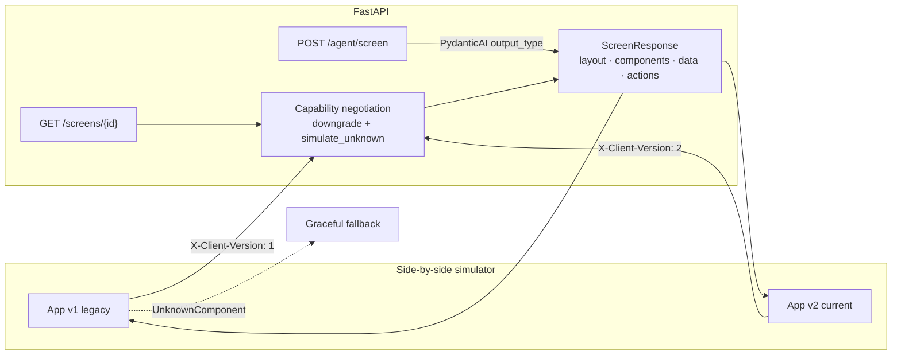

# server-driven-ui-pydantic

Lean monorepo demonstrating **Server-Driven UI (SDUI)** + **safe Generative UI** for a fintech onboarding & checkout flow.

| Layer | Stack |
| --- | --- |
| `api/` | Python 3.12 · FastAPI · Pydantic v2 · PydanticAI |
| `web/` | Vite · React · TypeScript |

Zero API keys required — the agent runs on PydanticAI `FunctionModel` / `TestModel` out of the box. Set `OPENAI_API_KEY` or `ANTHROPIC_API_KEY` to use a real LLM.

## Architecture



**Why SDUI (not a classic BFF)?** The server owns *what* to render (structure, catalog, copy, actions) while clients stay thin renderers. Version negotiation and downgrade live next to the contract, so App v1 and App v2 share one API without forked endpoints. Generative UI plugs into the same `ScreenResponse` — the LLM cannot invent a parallel schema.

## Compatibility (v1 ↔ v2)

| Component | App v1 | App v2 |
| --- | --- | --- |
| `header`, `text`, `input`, `button` | ✅ | ✅ |
| `pix_qr` | ↓ text + copyable Pix key | ✅ native QR |
| `biometric_prompt` | ↓ verification `input` + `button` | ✅ native prompt |
| unknown / `?simulate_unknown=true` | `UnknownComponent` | `UnknownComponent` |

Headers: `X-Client-Version` (`1` \| `2`), optional `X-Supported-Components` (comma-separated; intersected with the version catalog).

## Quickstart

```bash
# Backend
cd api
python -m venv .venv && source .venv/bin/activate
pip install -e ".[dev]"
uvicorn app.main:app --reload --port 8000

# Frontend (separate terminal)
cd web
npm install
npm run dev
```

Open http://localhost:5173 — App v1 and App v2 load `welcome → payment → confirmation` side by side. Toggle **simulate_unknown**, click through navigate/submit actions, or POST a prompt via the agent box.

Optional: copy `.env.example` → `.env` and set an LLM key. Never commit `.env`.

### Export JSON Schema (for TS sync)

```bash
curl -s http://localhost:8000/schema/screen > screen.schema.json
```

Types live in `web/src/types/sdui.ts` and mirror the Pydantic contract.

## Tests & CI

```bash
# api/
ALLOW_MODEL_REQUESTS=False pytest -q

# web/
npm run typecheck && npm test && npm run build
```

GitHub Actions (`.github/workflows/ci.yml`) runs both jobs on PRs to `main`.

## Roadmap (v2: A2UI 1.0 adapter)

- Optional adapter mapping `ScreenResponse` → [A2UI 1.0](https://a2ui.org) without rewriting the fintech catalog.
- Streaming generative UI and richer action effects (`open_modal` hosts).
- Schema-driven codegen from `GET /schema/screen` into `web/src/types/`.

## Contributing

See `AGENTS.md` for engineering standards (lean PRs, contract-as-source-of-truth, no secrets/planning docs).

## License

MIT — see `LICENSE`.
